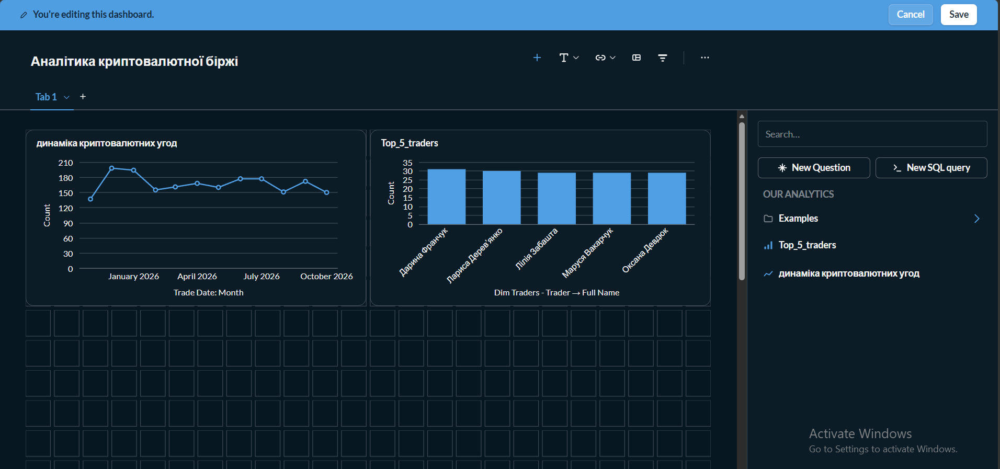
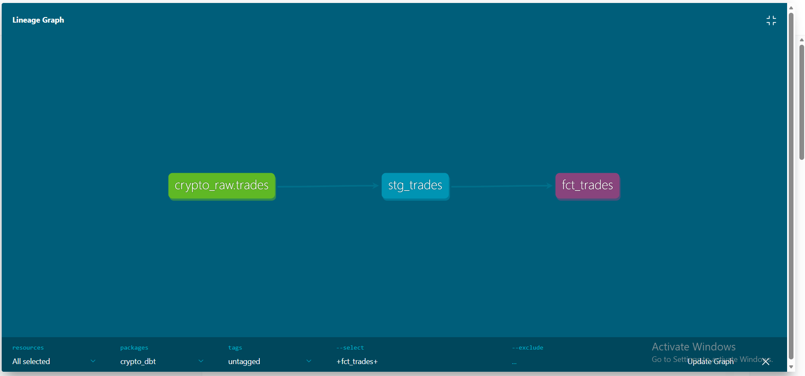

# Crypto Exchange — Modern Data Stack

## Лабораторна робота №4
**Дисципліна:** Технології сховищ даних  
**Варіант:** №9 — Криптобіржа  
**Тема:** Business Intelligence, Data Governance та Data Lineage

## 1. Опис проєкту

Проєкт демонструє створення аналітичного сховища даних для криптовалютної біржі.

Метою є генерація та обробка даних про криптовалютні операції, побудова аналітичних графіків у Metabase та відстеження походження даних за допомогою dbt.

## 2. Використані технології

| Технологія | Призначення |
|---|---|
| Python | Генерація та завантаження даних |
| Pandas, Faker | Створення тестових даних |
| PostgreSQL 15 | Сховище даних |
| Docker | Контейнеризація сервісів |
| dbt Core | Очищення та трансформація даних |
| Metabase | Побудова графіків та дашбордів |
| GitHub | Зберігання коду проєкту |

## 3. Структура бази даних

Проєкт містить п'ять основних таблиць:

- `traders` — користувачі криптобіржі.
- `currencies` — криптовалюти.
- `wallets` — гаманці користувачів.
- `trades` — операції купівлі та продажу.
- `deposits_withdrawals` — поповнення та виведення коштів.

Дані генеруються штучно та завантажуються у схему `raw` PostgreSQL.

## 4. Архітектура проєкту

Python → Parquet → PostgreSQL (raw) → dbt (staging) → dbt (analytics) → Metabase

Трансформація даних здійснюється за допомогою dbt. Аналітичний шар містить таблиці `fct_trades` та `dim_traders`.

## 5. Запуск проєкту

Для запуску необхідні Docker, Python та встановлені залежності проєкту.

Запуск контейнерів:

`docker compose up -d`

Генерація даних:

`python data_generator.py`

Завантаження даних у PostgreSQL:

`python load_to_dwh.py`

Для запуску dbt необхідно перейти до папки `crypto_dbt`, завантажити змінні з `.env` та виконати:

`dbt run --select +dim_traders +fct_trades --profiles-dir .`

Перевірка моделей:

`dbt test --select fct_trades dim_traders --profiles-dir .`

Генерація документації:

`dbt docs generate --profiles-dir .`

Запуск документації:

`dbt docs serve --profiles-dir . --port 8080`

## 6. Результати проєкту

### Аналітичний дашборд

У Metabase побудовано два графіки:

1. **Динаміка криптовалютних угод** — кількість угод за місяцями.
2. **Топ-5 трейдерів** — користувачі з найбільшою кількістю торгових операцій.

Обидва графіки об'єднано в дашборд «Аналітика криптовалютної біржі».

### Data Lineage

За допомогою dbt згенеровано документацію та граф залежностей між джерелами даних і аналітичними моделями.

Основний шлях трансформації:

`crypto_raw.trades → stg_trades → fct_trades`

## 7. Висновок

Під час виконання лабораторної роботи було розгорнуто аналітичну інфраструктуру криптовалютної біржі з використанням Docker, PostgreSQL, Python, dbt та Metabase.

Створено аналітичні таблиці, побудовано два бізнес-графіки й дашборд, а також згенеровано документацію та Data Lineage для відстеження походження даних.